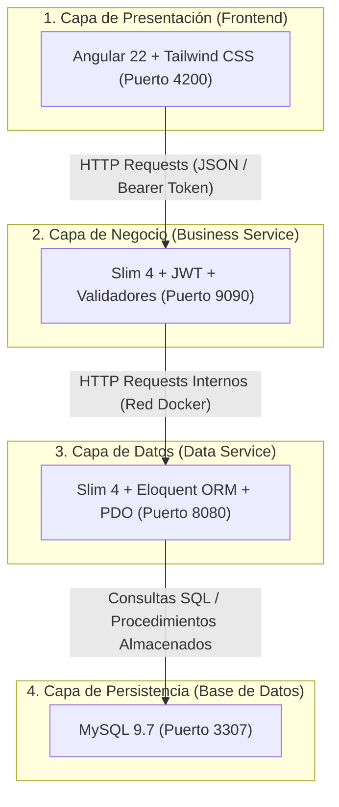
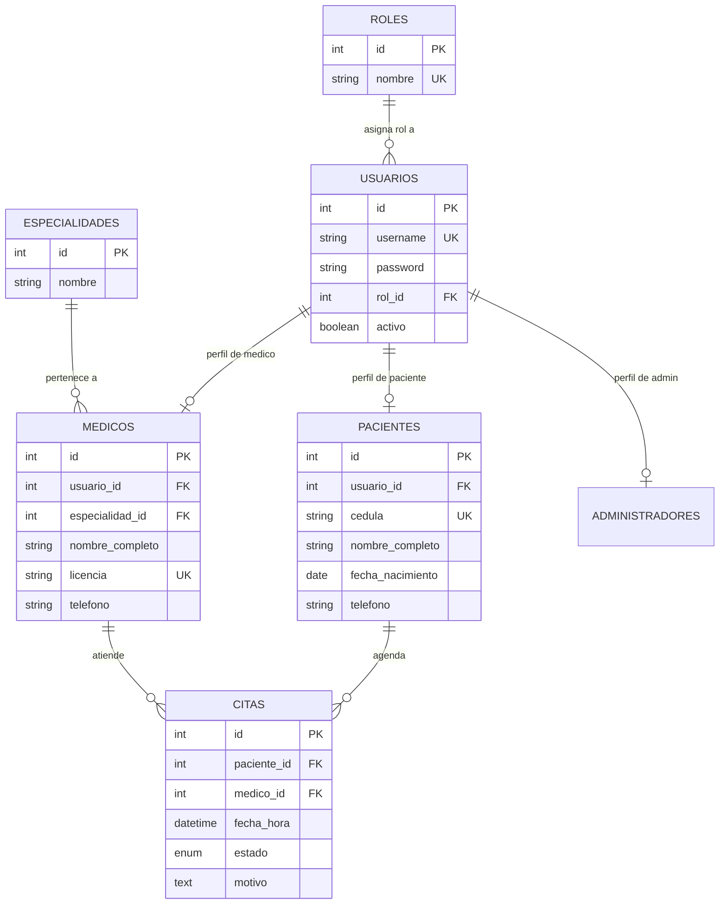
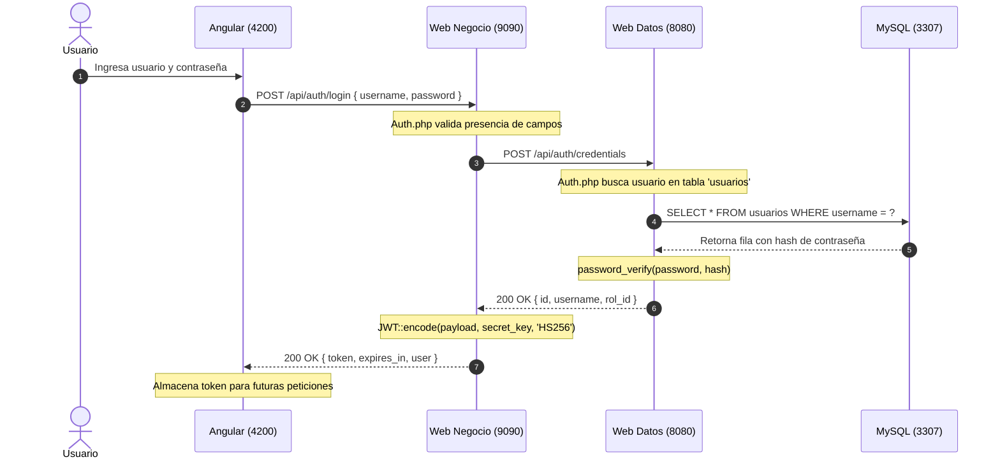
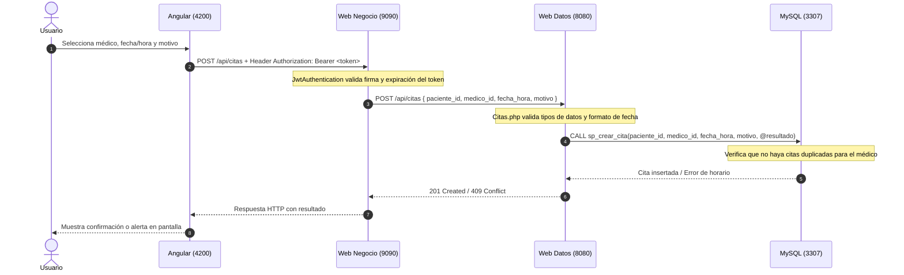

# Guía de Estudio y Documentación Técnica del Sistema de Citas Médicas (MedicalAppointments)

Este documento es una guía integral de arquitectura, componentes, tecnologías y flujos del sistema **MedicalAppointments**. Está diseñado como material de estudio para comprender en profundidad cada capa del proyecto, qué contiene cada módulo, por qué se diseñó de esta manera y cómo se comunican sus componentes.

---

## 1. Visión General del Proyecto

### 1.1 Propósito
El sistema tiene como objetivo gestionar citas médicas en una clínica u hospital, permitiendo:
- Administrar usuarios, roles y credenciales.
- Gestionar médicos con sus especialidades médicas y licencias.
- Gestionar pacientes con sus datos personales y números de identificación.
- Agendar, consultar y cancelar citas médicas previniendo solapamiento de horarios.

### 1.2 Patrón de Arquitectura: Arquitectura por Capas / Microservicios Desacoplados
El proyecto implementa una arquitectura desacoplada de cuatro capas principales, donde cada capa tiene una responsabilidad única y aislada:

---

## 2. Infraestructura y Orquestación con Docker

Toda la infraestructura está automatizada mediante **Docker** y **Docker Compose** en el archivo `docker-compose.yml`.

| Servicio Docker | Contenedor | Imagen Base / Runtime | Puerto Externo : Interno | Responsabilidad Principal |
| :--- | :--- | :--- | :--- | :--- |
| **`db`** | `base_datos` | `mysql:9.7` | `3307 : 3306` | Almacenamiento persistente relacional de datos. |
| **`webdatos`** | `web_datos` | PHP 8.5 (Apache) | `8080 : 80` | Acceso directo a base de datos (CRUD y ORM). |
| **`webnegocio`** | `web_negocio` | PHP 8.5 (Apache) | `9090 : 80` | Lógica de negocio, autenticación JWT y validaciones. |
| **`webpresentacion`** | `web_presentacion` | Node 24 (Build) + Nginx Alpine (Runtime) | `4200 : 80` | Interfaz gráfica de usuario en navegador web. |

### Conceptos Clave de Docker en este Proyecto:
1. **Docker Secrets (`db_password.txt`)**: En lugar de escribir contraseñas en texto plano dentro del código o variables de entorno expuestas, se usa la directiva `secrets:`. MySQL y PHP leen la contraseña desde un archivo montado en tiempo de ejecución (`/run/secrets/db_password`).
2. **Volúmenes Vinculados (`bind mounts`)**:
   - En `Data` y `Business`: Las carpetas locales `./Data/src` y `./Business/src` están montadas en `/var/www/html/src`. Esto permite modificar código PHP en Windows y que se refleje inmediatamente en el contenedor sin reconstruir la imagen.
   - En `db`: La carpeta `./mysql` preserva los datos del motor aunque el contenedor se destruya. `./db_dump` ejecuta automáticamente los scripts de creación de base de datos la primera vez que se inicia MySQL.
3. **Compilación Multi-Stage (Presentación)**:
   - `Presentation/Dockerfile` tiene 2 etapas:
     1. **Stage 1 (Build)**: Usa `node:24-alpine` con `pnpm` para ejecutar `pnpm run build` y generar los archivos estáticos optimizados (`.js`, `.css`, `.html`).
     2. **Stage 2 (Servidor)**: Usa `nginx:alpine` para copiar únicamente los archivos resultantes y servirlos con Nginx en el puerto 80, optimizando drásticamente el peso y seguridad de la imagen final.

---

## 3. Capa de Base de Datos (`citas_medicas`)

El archivo `db_dump/scripts.sql` define la estructura relacional y los procedimientos almacenados.

### 3.1 Modelo de Entidades y Relaciones

### 3.2 Procedimientos Almacenados (*Stored Procedures*)

En lugar de delegar toda la lógica a la aplicación, la base de datos cuenta con procedimientos para asegurar integridad y atomicidad:

1. **`sp_crear_cita`**:
   - Parámetros: `paciente_id`, `medico_id`, `fecha_hora`, `motivo`, `OUT p_resultado`.
   - **Regla de negocio en SQL**: Consulta `SELECT COUNT(*)` para verificar si el médico ya tiene otra cita en estado `'Programada'` exactamente en la misma fecha y hora. Si existe, no inserta y retorna un error; si no, inserta el registro y retorna éxito.
2. **`sp_obtener_citas_paciente`**:
   - Realiza `INNER JOIN` entre `citas`, `medicos` y `especialidades` para listar todas las citas de un paciente con el nombre del médico y su especialidad en orden cronológico descendente.
3. **`sp_obtener_citas_medico`**:
   - Realiza `INNER JOIN` entre `citas` y `pacientes` para listar la agenda de un médico específico.

---

## 4. Capa de Datos (`Data/`)

Es el microservicio backend de más bajo nivel. Su función es interactuar directamente con la base de datos y ofrecer endpoints JSON limpios para lectura y escritura.

### 4.1 Tecnologías Utilizadas
- **Slim Framework 4**: Encargado del enrutamiento de peticiones HTTP (GET, POST, PUT, DELETE) y la canalización de middleware siguiendo los estándares **PSR-7** (mensajes HTTP) y **PSR-15** (middleware).
- **PHP-DI (`Container`)**: Contenedor de inyección de dependencias para registrar y obtener servicios centralizados como la conexión a base de datos y el ORM.
- **PDO Puro (`Data/src/app/conexion.php`)**: Para ejecutar consultas de procedimientos almacenados (`CALL sp_crear_cita(...)`).
- **Eloquent ORM (`Illuminate\Database\Capsule\Manager`)**: Para el mapeo relacional de objetos. Permite consultar tablas como modelos PHP orientados a objetos (`CitasModel::all()`, `Medico::find($id)`).

### 4.2 Estructura de Carpetas en `Data/src/`
- **`app/`**:
  - `App.php`: Punto de entrada del microservicio. Carga variables de entorno (`.env`), inicializa Slim, registra el contenedor de dependencias y configura los manejadores globales de error (404 Not Found y 405 Method Not Allowed en JSON).
  - `config.php`: Extrae variables de entorno (`DB_HOST`, `DB_NAME`, `DB_USER`) y lee la contraseña desde `/run/secrets/db_password`.
  - `conexion.php`: Crea y registra la instancia PDO en el contenedor bajo la clave `'base_datos'`.
  - `eloquent.php`: Inicializa y arranca Eloquent Capsule (`bootEloquent()`), disponible bajo la clave `'eloquent'`.
  - `routes.php`: Mapea rutas HTTP a métodos en controladores.
- **`Models/`**:
  - `User.php`: Modelo de Eloquent para la tabla `usuarios`.
  - `Medico.php`: Modelo de Eloquent para la tabla `medicos`.
  - `PacienteModel.php`: Modelo de Eloquent para la tabla `pacientes`.
  - `CitasModel.php`: Modelo de Eloquent para la tabla `citas`.
- **`controllers/`**:
  - `Auth.php`: Verifica si un usuario y contraseña coinciden con la base de datos usando `password_verify()`.
  - `Medico.php`: CRUD de médicos (creación transaccional con usuario, actualización, eliminación lógica o física, paginación con `filter/{offset}/{limit}`).
  - `Paciente.php`: CRUD de pacientes y paginación.
  - `Citas.php`: Lectura de citas, obtención por paciente/médico y ejecución del procedimiento almacenado `sp_crear_cita`.

---

## 5. Capa de Negocio (`Business/`)

Es el microservicio intermediario que actúa como fachada y guardia de seguridad. No se conecta a MySQL directamente; su única vía de datos es comunicarse por HTTP con `webdatos`.

### 5.1 Tecnologías y Librerías Utilizadas
- **Slim Framework 4**: Servidor de rutas de la API de negocio.
- **GuzzleHttp 7 (`Client`)**: Cliente HTTP usado por `DataService` para consumir el microservicio `webdatos` (`http://webdatos/api/...`).
- **Firebase JWT (`firebase/php-jwt`)**: Generación y firma de tokens criptográficos con clave secreta y algoritmo `HS256`.
- **JimTools JWT Auth (`JimTools\JwtAuth`)**: Middleware PSR-15 que intercepta cada petición entrante, decodifica el token en la cabecera `Authorization: Bearer <token>` y rechaza peticiones no autorizadas (HTTP 401).
- **Respect/Validation (`Respect\Validation\ValidatorBuilder`)**: Motor declarativo de validación de reglas de negocio para asegurar formato estricto de contraseñas, nombres, teléfonos y documentos.

### 5.2 Estructura de Carpetas en `Business/src/`
- **`app/`**:
  - `App.php`: Configura Slim, inyección de dependencias, el middleware de autenticación JWT excluyendo las rutas públicas (`/api/auth/login`, `/api/medicos`), y los manejadores de error 401, 404 y 405.
  - `config.php`: Define la URL del servicio de datos (`http://webdatos/api`), tiempo de expiración del token (`jwt_ttl = 3600`), y la llave secreta (`KEY`).
  - `routes.php`: Agrupa los endpoints bajo el prefijo `/api/`.
- **`Services/`**:
  - `DataService.php`: Clase que encapsula las peticiones `get()`, `post()`, `put()` y `delete()` hacia el microservicio de datos. Captura excepciones de conexión (`ConnectException`, `RequestException`) para devolver respuestas HTTP 502 claras.
- **`Validators/`**:
  - `MedicoValidator.php`: Reglas estrictas:
    - `nombre_completo`: entre 11 y 150 caracteres, únicamente letras y espacios.
    - `licencia`: entre 1 y 50 caracteres.
    - `username`: entre 8 y 16 caracteres alfanuméricos en minúscula sin espacios.
    - `password`: entre 8 y 64 caracteres, exigiendo al menos una mayúscula, una minúscula, un dígito y un símbolo especial (`#$@*`).
    - `telefono`: formato exacto `####-####`.
  - `PacienteValidator.php`: Reglas análogas para cédula, nombre, fecha de nacimiento y contacto.
- **`controllers/`**:
  - `Auth.php`:
    - Valida que `username` y `password` no estén vacíos.
    - Llama a `DataService->post('auth/credentials')`.
    - Si las credenciales son válidas, firma y retorna un token JWT que incluye el rol del usuario (`rol_id`), ID y username.
  - `Medico.php`: Valida las entradas con `MedicoValidator`. Si hay errores devuelve HTTP 422 con la lista de campos inválidos; si todo es válido, reenvía la petición al servicio de datos.
  - `Paciente.php`: Valida y reenvía al servicio de datos.
  - `Citas.php`: Reenvía consultas y solicitudes de creación al servicio de datos.

---

## 6. Capa de Presentación (`Presentation/`)

Es la aplicación cliente ejecutada en el navegador web.

### 6.1 Tecnologías Utilizadas
- **Angular 22**:
  - **Componentes Standalone**: Arquitectura moderna sin `NgModule`, donde los componentes declaran directamente sus importaciones (`imports: [RouterOutlet]`).
  - **Signals (`signal('citas')`)**: Sistema reactivo de estado para actualizar la interfaz de manera eficiente sin sobrecargar la detección de cambios.
  - **Enrutamiento Declarativo (`app.routes.ts`)**: Para la navegación entre vistas mediante `<router-outlet />`.
- **Tailwind CSS v4**: Framework de utilidades CSS moderno configurado a través de `@tailwindcss/postcss`.
- **Nginx Alpine**: Servidor web ultraligero que aloja los archivos compilados y redirige todas las rutas al `index.html` (`try_files $uri $uri/ /index.html;`) para permitir enrutamiento del lado del cliente (*Single Page Application*).

---

## 7. Flujo Completo de una Petición (Request Lifecycle)

### Caso 1: Inicio de Sesión (`POST /api/auth/login`)

### Caso 2: Agendamiento de Cita (`POST /api/citas`)

---

## 8. Mapa de Endpoints de la API

| Capa | Método | Ruta | Protegida por JWT | Descripción |
| :--- | :--- | :--- | :--- | :--- |
| **Business (9090)** | `POST` | `/api/auth/login` | No (Pública) | Autentica y genera el token JWT. |
| **Business (9090)** | `GET` | `/api/medicos` o `/api/medico` | No (Pública) | Lista todos los médicos registrados. |
| **Business (9090)** | `GET` | `/api/medicos/{id}` | No (Pública) | Obtiene un médico por su identificador. |
| **Business (9090)** | `POST` | `/api/medicos` | Sí (Token requerido) | Valida datos y crea un nuevo médico. |
| **Business (9090)** | `PUT` | `/api/medicos/{id}` | Sí (Token requerido) | Valida datos y actualiza un médico existente. |
| **Business (9090)** | `DELETE`| `/api/medicos/{id}` | Sí (Token requerido) | Elimina un médico. |
| **Business (9090)** | `GET` | `/api/pacientes` o `/api/paciente` | Sí (Token requerido) | Lista los pacientes. |
| **Business (9090)** | `POST` | `/api/pacientes` | Sí (Token requerido) | Valida y crea un nuevo paciente. |
| **Business (9090)** | `GET` | `/api/citas` o `/api/cita` | Sí (Token requerido) | Lista todas las citas médicas registradas. |
| **Business (9090)** | `GET` | `/api/citas/{id}` | Sí (Token requerido) | Obtiene el detalle de una cita por su ID. |
| **Business (9090)** | `GET` | `/api/citas/paciente/{id}` | Sí (Token requerido) | Lista el historial de citas de un paciente. |
| **Business (9090)** | `GET` | `/api/citas/medico/{id}` | Sí (Token requerido) | Lista la agenda de citas de un médico. |
| **Business (9090)** | `POST` | `/api/citas` | Sí (Token requerido) | Agenda una nueva cita médica. |
| **Data (8080)** | `POST` | `/api/auth/credentials` | Interna | Verifica credenciales contra base de datos. |
| **Data (8080)** | `GET` | `/api/citas[/{id}]` | Interna | Consulta citas en BD usando Eloquent. |
| **Data (8080)** | `POST` | `/api/citas` | Interna | Llama al procedimiento almacenado `sp_crear_cita`. |

---

## 9. Conceptos Teóricos Clave para Exámenes y Estudio

1. **¿Por qué separar la Capa de Datos de la Capa de Negocio?**
   - **Principio de Responsabilidad Única (SRP)**: La capa de datos únicamente sabe cómo consultar, mapear y persistir información en el motor de base de datos. La capa de negocio contiene las reglas del dominio (quién puede agendar, qué formato de contraseña se exige, cómo se validan las licencias, emisión de tokens).
   - **Seguridad**: La capa de datos no se expone a internet; solo es accesible dentro de la red interna de contenedores por la capa de negocio.
   - **Mantenibilidad e Intercambiabilidad**: Si en el futuro se cambia MySQL por PostgreSQL, solo se modifica la capa de datos; la lógica de negocio, validadores y el frontend permanecen intactos.

2. **¿Cómo funciona un JWT (JSON Web Token)?**
   - Consta de tres partes separadas por puntos (`Header.Payload.Signature`):
     - **Header**: Especifica el algoritmo (`HS256`) y el tipo de token (`JWT`).
     - **Payload**: Contiene los *claims* o datos de la sesión (`sub`: ID de usuario, `rol_id`, fecha de expiración `exp`).
     - **Signature**: Se genera cifrando el Header y Payload con una clave secreta que solo el servidor de negocio conoce. Esto garantiza que el cliente no pueda alterar su rol (ejemplo: cambiarse de paciente a administrador) sin invalidar la firma.

3. **¿Cuál es la diferencia entre un ORM y un Procedimiento Almacenado?**
   - **ORM (Eloquent)**: Mapea registros de tablas a objetos PHP. Facilita operaciones CRUD comunes, relaciones entre modelos y legibilidad de código.
   - **Procedimiento Almacenado (`Stored Procedure`)**: Bloque de código SQL precompilado que se ejecuta directamente en el motor de base de datos. Se utiliza en operaciones críticas (como `sp_crear_cita`) donde se requiere alta velocidad y chequeo atómico para evitar condiciones de carrera (*race conditions* en reservas simultáneas).

4. **Códigos de Estado HTTP Utilizados en el Proyecto**:
   - `200 OK`: Consulta o autenticación exitosa.
   - `201 Created`: Recurso creado exitosamente (médico, paciente, cita).
   - `401 Unauthorized`: Token JWT ausente, expirado o manipulado.
   - `404 Not Found`: Ruta no existente o registro no encontrado en base de datos.
   - `405 Method Not Allowed`: Método HTTP incorrecto para una ruta válida (ejemplo: hacer un `DELETE` sobre una ruta que solo acepta `POST`).
   - `422 Unprocessable Entity`: Error de validación en los campos enviados (ejemplo: contraseña débil, formato de teléfono incorrecto).
   - `502 Bad Gateway`: La capa de negocio intentó comunicarse con la capa de datos pero esta no estaba disponible.
